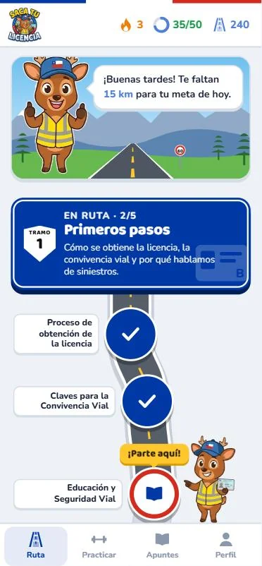
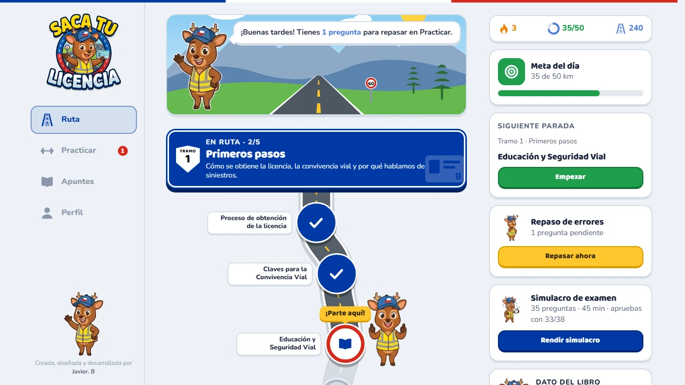

# 🚗 Saca tu Licencia Chile - Aprende a conducir jugando 🇨🇱

App web para preparar el **examen teórico de la Licencia Clase B en Chile**, basada en el
*Libro para la Conducción en Chile* de CONASET (actualización de agosto de 2024).
Se aprende como en un juego: una ruta que parte por lo más básico, vidas en forma de bencina,
kilómetros, rachas y **Huemi**, el huemul que te acompaña y te explica cada respuesta.

**Creada, diseñada y desarrollada por Javier. B.**

<p align="center">
  
  &nbsp;
  
</p>

## Qué trae

- **Ruta de 10 tramos y 54 lecciones**, ordenada de lo más básico a lo más avanzado. Cada tramo termina con un **control** (disco PARE).
- **533 preguntas** de selección múltiple y verdadero o falso, con la explicación, la página y la cita del libro en cada respuesta.
- **Huemi** explica la teoría antes de cada lección y reacciona cuando aciertas o fallas.
- **Apuntes** de cada lección, sacados del libro.
- **Simulacro con el formato oficial**: 35 preguntas, 3 de doble puntaje, 45 minutos; se aprueba con 33 de 38 puntos.
- **Repaso espaciado** de las preguntas falladas (vuelven a los 1, 3, 7, 14 y 30 días), diagnóstico inicial, repasos por unidad y evaluación general.
- Bencina (vidas), kilómetros, meta diaria, racha y 12 logros.
- Funciona en **celulares y computadores**, con modo claro u oscuro, y sigue funcionando sin conexión después de la primera visita.
- El progreso se guarda en el navegador y se puede descargar como respaldo.

## Publicar en GitHub Pages

1. Crea un repositorio nuevo en GitHub (por ejemplo `saca-tu-licencia`).
2. Sube **todo el contenido de esta carpeta** a la raíz del repositorio, con `index.html` en la raíz.
   - Desde la web: *Add file → Upload files*, arrastra todos los archivos y carpetas y confirma con *Commit changes*.
   - O con git:
     ```bash
     git init
     git add .
     git commit -m "Saca tu Licencia"
     git branch -M main
     git remote add origin https://github.com/TU-USUARIO/saca-tu-licencia.git
     git push -u origin main
     ```
3. En el repositorio entra a **Settings → Pages**.
4. En *Build and deployment* elige **Source: Deploy from a branch**, rama **main** y carpeta **/ (root)**, y guarda.
5. En uno o dos minutos la app queda en `https://TU-USUARIO.github.io/saca-tu-licencia/`.

Todas las rutas del proyecto son relativas, así que funciona dentro de la subcarpeta del repositorio sin cambiar nada.
El archivo `.nojekyll` le indica a GitHub Pages que publique los archivos tal cual.

> **Al actualizar la app:** la app se guarda para funcionar sin conexión. Si subes cambios y no los ves,
> recarga la página una o dos veces. Si cambias archivos, sube también el número de `CACHE` en `sw.js`
> (por ejemplo `licencia-b-v6`) para que los celulares descarguen la versión nueva.

## Convertirla en app con AppCreator24

1. Publica primero en GitHub Pages y copia la dirección (`https://TU-USUARIO.github.io/saca-tu-licencia/`).
2. En AppCreator24 crea una app con una sección de tipo **Web / URL** y pega esa dirección.
3. Si aparecen estas opciones, déjalas activadas: JavaScript, almacenamiento local (*DOM storage*) y orientación vertical.
4. Usa `icons/icono-512.png` como ícono de la app.

Ten en cuenta:
- El progreso queda guardado dentro de la app del teléfono. Si se desinstala, se pierde: para no perderlo, descarga un respaldo en **Perfil → Respaldo del progreso** (en algunas apps hechas con AppCreator24 la descarga de archivos puede no estar permitida).
- El botón *atrás* del celular cierra ventanas y pide confirmación antes de salir de una lección.

## Probar en tu computador

El navegador no deja leer el banco de preguntas si abres `index.html` con doble clic, así que hay que usar un servidor local:

```bash
python -m http.server 8000
```

y abrir `http://localhost:8000`.

## Estructura

| Archivo | Para qué sirve |
|---|---|
| `index.html` | Página principal |
| `app.js` | Lógica de la app: ruta, sesiones, progreso y pantallas |
| `ruta.js` | Orden de los tramos y formato del examen oficial |
| `ilustraciones.js` | Escena de la cordillera e íconos de cada tramo |
| `styles.css` | Diseño para celular y computador |
| `banco_preguntas_licencia_clase_b.json` | Banco de 533 preguntas con su fuente en el libro |
| `sw.js`, `manifest.webmanifest` | Funcionamiento sin conexión e instalación como app |
| `img/` | Huemi en todas sus poses y el logo |
| `icons/` | Íconos de la app |

## Fuentes y aviso

- Contenido: *Libro para la Conducción en Chile – Automovilistas Licencia Clase B*, CONASET ([mejoresconductores.conaset.cl](https://mejoresconductores.conaset.cl)). Cada pregunta indica la página y la cita que la respalda.
- Formato del examen: [CONASET](https://www.conaset.cl/mtt-presenta-nuevo-libro-de-conduccion-y-suma-importantes-actualizaciones-en-electromovilidad-y-seguridad-infantil/) y [MTT, preguntas frecuentes](https://www.mtt.gob.cl/preguntas-frecuentes-nuevo-examen-teorico).
- Las preguntas del examen oficial no son públicas: esta app es para practicar y no reemplaza al examen ni al libro. No es una app oficial de CONASET ni del Ministerio de Transportes.

## 🛠️ Creador

Proyecto creado, diseñado y desarrollado por **Javier. B**.
